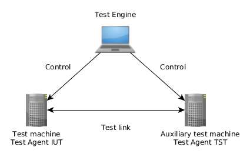

# NET-DRV-TS - testing network interface driver

NetDrv TS carries out testing and performance evaluation of kernel network drivers.

The test suite covers (list not exhaustive):

* basic operations, e.g. querying driver info, changing MAC or MTU, sending pings, etc;
* different kinds of offloading: TCO, LCO, GRO, etc;
* compatibility with ethtool;
* devlink API.

TE is used as an Engine that allows to prepare desired environment for every test.
This guarantees reproducible test results.

The following setup is used to run the tests:



## Getting started

Put the suite next to TE and the shared test configuration:

```
work/
  te/               https://github.com/ts-factory/test-environment
  ts-conf/          https://github.com/ts-factory/ts-conf
  ts-rigs/          your test rigs, see "Adding a configuration"
  net-drv-ts/       this repository
```

The scripts find `te`, `ts-conf` and `ts-rigs` there on their own; set
`TE_BASE`, `SF_TS_CONFDIR` or `TE_TS_RIGSDIR` if you keep them elsewhere.

## Running tests

```
./scripts/run.sh --cfg=<name>
```

`<name>` is a configuration from `ts-rigs/run/`. The first run
builds TE, the test agents and the suite; later runs rebuild only what
changed.

Useful options:

* `--tester-run=net-drv-ts/basic/driver_info` runs one test (or a whole
  package, e.g. `net-drv-ts/basic`);
* `--log-html=html` writes a browsable log to `html/`;
* `--help` lists the rest.

## Adding a configuration

A configuration is two small files in `ts-rigs`, named after
the `--cfg` value. `run/<name>` holds options for `run.sh`, usually
just the environment to load:

```
--script=env/<name>
```

`env/<name>` describes the hosts and the NICs that connect them:

```
# Host with the NIC under test, and the tester host
export TE_IUT=host1
export TE_TST1=host2

# NIC port on the IUT connected to the tester (PCI IDs, port number)
# and the kernel driver under test
export TE_PCI_VENDOR_IUT_TST1=8086
export TE_PCI_DEVICE_IUT_TST1=1592
export TE_PCI_INSTANCE_IUT_TST1=0
export TE_ENV_IUT_NET_DRIVER=ice

# Its peer port on the tester
export TE_PCI_VENDOR_TST1_IUT=8086
export TE_PCI_DEVICE_TST1_IUT=1592
export TE_PCI_INSTANCE_TST1_IUT=0
```

The hosts need password-less SSH and sudo for the user running the
tests. [ts-rigs-sample](https://github.com/ts-factory/ts-rigs-sample)
is a complete example to start from, with more variables (drivers, SSH
settings) and ready configurations for several NICs.

## Documentation

```
export DOXYREST_PREFIX=/path/to/doxyrest
./scripts/gen_doxygen --html
```

Open `net-drv-ts/doc/generated/html/index.html`. You need doxygen,
sphinx and doxyrest; `$TE_BASE/scripts/doxyrest_deploy.sh --put` installs
doxyrest next to `te/`.

Each test page is built from the test source itself: the scenario
steps, nested under the conditions and loops that guard them, and the
parameters with their descriptions from the `TEST_PARAM_DOC()` calls.
Reading the source needs libclang:

```
apt install python3-clang     # or: pip install libclang
```

Without it the documentation still builds, but the scenarios come out
flat and the parameter lists are missing.
